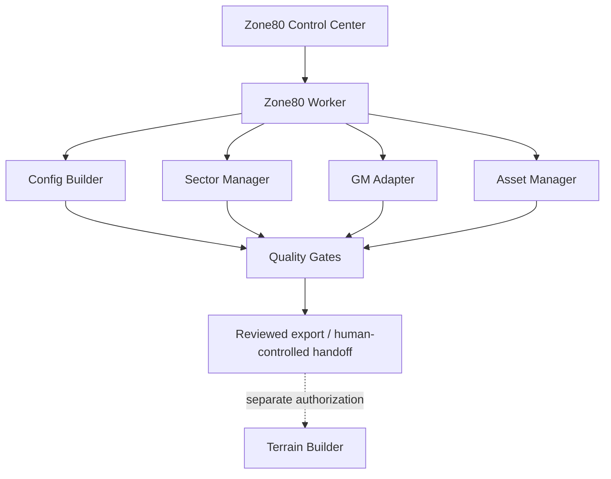

# Zone80 Control Center — план автономной разработки

Дата: 25.11.2026. Владелец попросил закрепить предложенный семиэтапный план. Baseline b53d0db35a384efac84b84199bda98c6db8548fe, Draft PR #47, Issue #42. Это план разработки, не отчёт о выполнении и не новое разрешение на native generation. Stage 001 / PARTIAL. Номера CC-01…07 — подэтапы инструментария, НЕ Stage 001…007 всего проекта.

## Цель

Локальная фабрика подготовки одной карты Arma 3 размером 81,92 × 81,92 км: 4096² × 20 м, 8×8 логических секторов по 10,24 км. Секторы — единицы подготовки/контроля, не 64 самостоятельных WRP. Production CRS, extent and epoch остаются не утверждены. Реальный пилот MAP-003: 64² × 30 м, EPSG:32636, 1920 × 1920 м; 3467 valid / 629 NoData; TB BLOCKED. Никакой подмены реального рельефа синтетическим.

## Архитектура

- **Worker:** локальный конечный планировщик, типизированные задания, зависимости, лимиты, блокировки, восстановление, отчёты. Не исполняет произвольные shell-команды или GitHub comments. [WORKER_CONTRACT](WORKER_CONTRACT.md) имеет приоритет по безопасности.
- **Config Builder:** воспроизводимая компиляция конфигурации GRM из явно утверждённых ресурсов, правил и версий. Существующий v03 — только ограниченный editor-only transformer; он не является готовым production compiler.
- **Sector Manager:** логическая сетка, идентификаторы, соседство, общие границы, зависимости входов, повторная обработка только затронутых секторов; не генерирует высоты.
- **GM Adapter:** импорт и проверка уже экспортированных владельцем GM26.2 высот, их передача в предусмотренную точку GRM. Адаптер не получает и не вычисляет реальные высоты взамен Global Mapper. Проектирование до нативного запуска.
- **Asset Manager:** manifest ресурсов, provenance, версии, семантическое соответствие и разрешения. Карта владеет геоданными/привязками; независимый ZPB — моделями. Не считать зарезервированные ID живыми ассетами.
- **Quality Gates:** CRS/grid, швы, координаты, stable IDs, отсутствие дублей, наличие и зависимости ресурсов, хеши, контроль разрешений. PASS синтетики не означает PASS игры.
- **Control Center:** локальный интерфейс статуса, очередь, выбор секторов, stop/resume, просмотр отчётов и повторная обработка после изменений. Только разрешённые типы задач; визуальные статусы из фактических state records, не демонстрационные данные.

## Семь подэтапов (порядок разработки)

| ID | Работа без Луны | Критерий приёмки автономной части | Что требует локальной проверки | Статус |
|---|---|---|---|---|
| CC-01 | Worker: Python stdlib candidate, typed registry, очередь DAG, lock, atomic state, attempts, stdout/stderr, hashes, preflight, finite synthetic_probe | Реальный конечный synthetic run, проверенный артефакт и state; зависимости и repeat/resume; запрет native kinds и arbitrary argv | Windows process ownership/Job Objects, реальные resource probes | DESIGN ONLY; NEXT |
| CC-02 | Fault injection: nonzero/false success, timeout, stop, crash/restart, concurrent runners, stale state/hash, dependency block, path escape, resource probes, descendants and unrelated sentinel | Повторяемые реальные тесты без ложного PASS; при сомнительном живом потомке BLOCKED, не дублировать старт; отказ не портит предыдущий артефакт | Windows crash/tree termination and locked desktop, detached survival separately | PLANNED |
| CC-03 | Sector Manager: 64 logical manifests, stable IDs, coordinate transforms against synthetic origin, neighbor and ownership contract, invalidation | 64 unique sectors, no gaps/positive overlap; exact shared boundaries and deterministic cross-border ownership; two-neighbor synthetic seam test; no production CRS approval | GM/TB actual transform and origin, real full-grid approval | PLANNED |
| CC-04 | Config Builder + Asset Manager core: typed rules, inventory/manifest lock, stable 11 RGB IDs/16 usages, texture/surface checks, dependencies, fail-closed output | Deterministic synthetic compiler; negatives for missing/duplicate/unknown/mismatch; editor-only and production modes explicitly distinct | Check 22 added stock refs, mud, ice, base-world, CfgPatches/entitlement and native parser | PARTIAL: v03 editor-only precursor; production PLANNED |
| CC-05 | GM→GRM adapter: pinned upstream source and transitive graph audit, data-provider seam, metadata/hash/CRS/grid/NoData validation, synthetic in-memory fixtures | No hidden RawElevationBuilder/network or new real heights; synthetic import validation incl NoData and wrong units/origin; source-level proof and bounded design or implementation if feasible | Real GM26.2 full N51E030 export, actual GRM adapter integration and authorized layer | PLANNED / native BLOCKED |
| CC-06 | Local Control Center: minimal read-only state dashboard first, then allowed queue controls, sector grid, logs and failure reasons | Offline synthetic UI data, command authorization, honest status, no arbitrary execution; test stop/resume and status refresh | Windows UI/runtime/session and local permissions | CONCEPT ONLY |
| CC-07 | Integration with Luna: prepare transfer bundle, test matrix, pinned commits, reproducible instructions | Reproducible synthetic cross-component integration, reports and safe handoff | Windows install/preflight, process survival, real dependencies, allowed GM export and one safe terrain-only TB import after gates; native GRM layer/scheduler separately approved | PLANNED / gated |

### Additional cross-cutting work
- Material library: semantic landcover-to-material rules, explicit Unknown, no assumptions based on absent tags; do not drop Ice usage or invent surface classes.
- Object placement: synthetic deduplication, stable ownership on sector borders, conflict/overlap detection; no actual map object placement at current stage.
- Optimization: deterministic small synthetic profiling, memory/density metrics, no claimed native performance without measurement.
- Test artifacts: exact commands, versions, UTC, exit codes, SHA256, outputs, peak resources where measurable, and negative test counts. Keep PASS/FAIL/PARTIAL/BLOCKED/NOT RUN per platform. No repeated tests solely for appearance of progress.

## Execution split and safety

ChatGPT/cloud: source review, pure algorithms, schemas, project-owned code and synthetic tests; documentation and sanitized reports in isolated draft PR. Local Windows/Luna: installed tools/licences, P: read-only resource inventory, Cfg class/dependency checks, native process management and source acquisition/export through Global Mapper. Parallel independent local MAP-003 GIS work need not wait for CC-01…06. Do not duplicate edits: inspect current HEAD, claim scope in Issue #42, coordinate via branch/commit, preserve previous results. No automatic merge.

No broad new data acquisition, no generated real heightmaps through Python/GDAL/CI, no writes to P:, no arbitrary tool automation, no mouse/SendKeys, no repeated TB SOAK, no full-world generation, no gentb/genwrp/genmod or WRP/PBO, no actual object placement, no scheduler/service registration or power settings changes, no stage promotion. Existing limited TB terrain-only import permission requires complete GM grid and proven safe separate sandbox. Native GRM and real unattended jobs remain gated. [Current checkpoint](../map/MAP_003_CURRENT_CHECKPOINT.md), [AGENTS](../../AGENTS.md), [minimal dependencies](../integration/MINIMAL_DEPENDENCIES.md), [ZPB contract](../integration/ZONE80_ZPB_CONTRACT.md).

## Start and stop

Next proposed development task: CC-01, working bounded synthetic worker in tools/automation/ plus tests, documented interface and reproducible logs. Then CC-02 before native integration. User request at this checkpoint is documentation only: no new code or tests executed here. Update PROJECT_STATE and ledger only when actual evidence arrives. The seven-step roadmap records direction; later real native actions require their existing gates. Continue existing Issue #42; no new microissues.

## CC-01 result / 2026-11-25
[CC01_RESULT](CC01_RESULT.md): bounded Linux synthetic core implemented and tested (9 unittest methods incl 14 invalid-manifest subcases, two CLI jobs PASS and verified resume skips). CC-01 cloud core PASS in scope; full WORKER_CONTRACT remains PARTIAL. Windows and real process-tree limits not implemented, no active cancellation or crash reconciliation proof. Next CC-02. No native execution or scheduler. Earlier table is the original plan, not the current execution state.

## CC-02 result / 2026-11-25
[CC02_RESULT](CC02_RESULT.md): Linux bounded synthetic fault-injection core, 13 tests PASS twice, actual SIGKILL runner recovery gated by inherited flock, active cancel/timeout and owned descendant cleanup, actual concurrent-run block, sampled RSS guard, checkpoint subprocess exit before/after replace. Completed A preserved across B crash and explicit recovery. Windows, arbitrary descendants, strict cgroup/tree private/commit limits, power loss and detached lifetime remain NOT RUN/PARTIAL. Full worker contract not accepted for native use. Next CC-03: synthetic logical sector manager; no geographic generation or stage promotion.

## CC-03 result / 2026-11-25
[CC03_RESULT](CC03_RESULT.md): 11 synthetic tests PASS twice; existing foundation generator/validator and config inputs verified by exact Git blobs and exercised in demo; 64 logical sectors, 112 shared edges, no positive core overlap, exact integer-mm anchor ownership and rational segment crossings, collinear review, missing adjacency detection, deterministic per-sector input digests, local dirty set (1 interior, 2 boundary, 64 global rule change). Only planning; no actual Worker submission or native geometry/seam generation. Next CC-04 Config Builder and Asset Manager, synthetic-only production gate checks. All geographic/native gates remain.

## CC-04 result / 2026-11-25
[CC04_RESULT](CC04_RESULT.md): six-module in-memory review assembler and asset audit, material usage/RGBA and road IDs locked, synthetic dependency graph validation, ZPB metadata review (all selections blocked). 13 Python test methods PASS twice. Actual owner v03 reviewed twice with identical report: 203 unique refs, 179 inventory-present, 22 unverified stock, 2 external, zero runtime-approved. Connector audit of four existing reference arrays: 204 unique refs, none approved. No native .grma3a release output, installed dependency proof or full recursive schema validation. Production compiler remains BLOCKED. Next CC-05 source-level GM adapter and synthetic read-only import tests; no real new elevations or native layer runs.

## CC-05 result / 2026-11-25
[CC05_RESULT](CC05_RESULT.md): 12 Python tests PASS twice, pinned actual MAP-003 diagnostic re-reviewed twice with identical JSON, five control samples match. ASC 3467 valid /629 NoData; explicit blocker. GRM source confirms BuildContext.SetData injection seam, mutable elevation processing and center-vs-node mismatch (15 m per axis at 30 m cell). Strict read-only validator, no C# patch/native provider or general WKT parser yet. Native integration BLOCKED; no new raster, no hidden elevation transformation. Next CC-06 offline Control Center; CC-07 local gates remain. Stage 001 PARTIAL.
